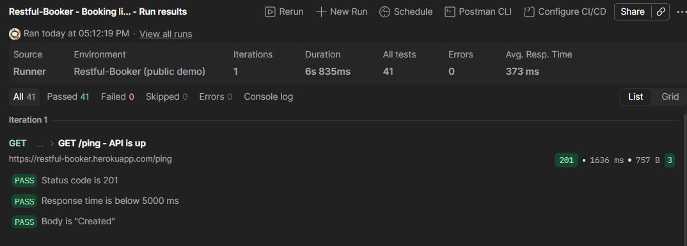
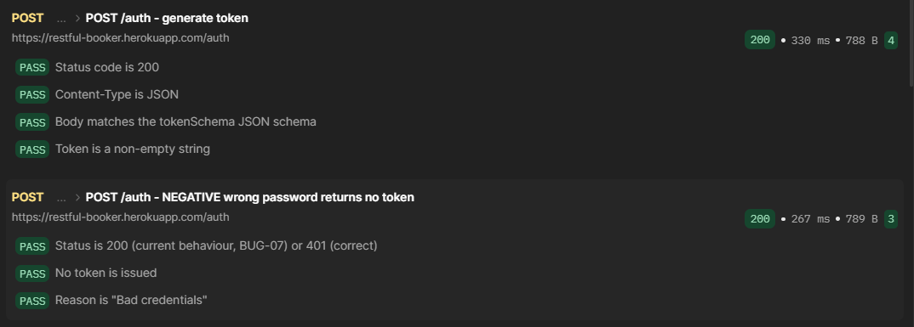
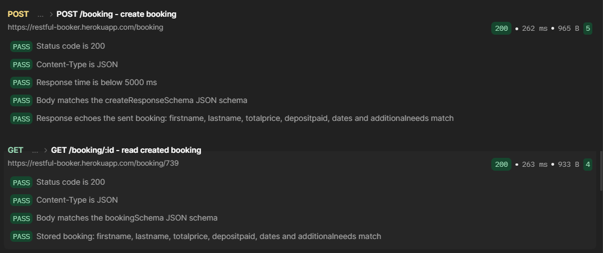
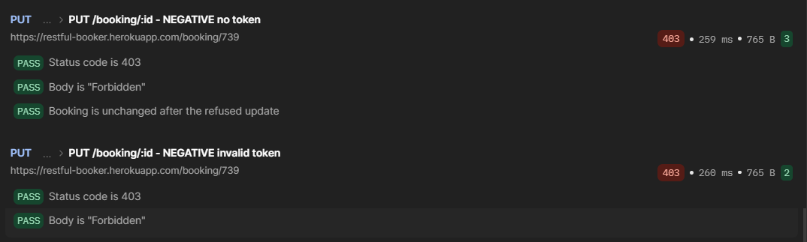
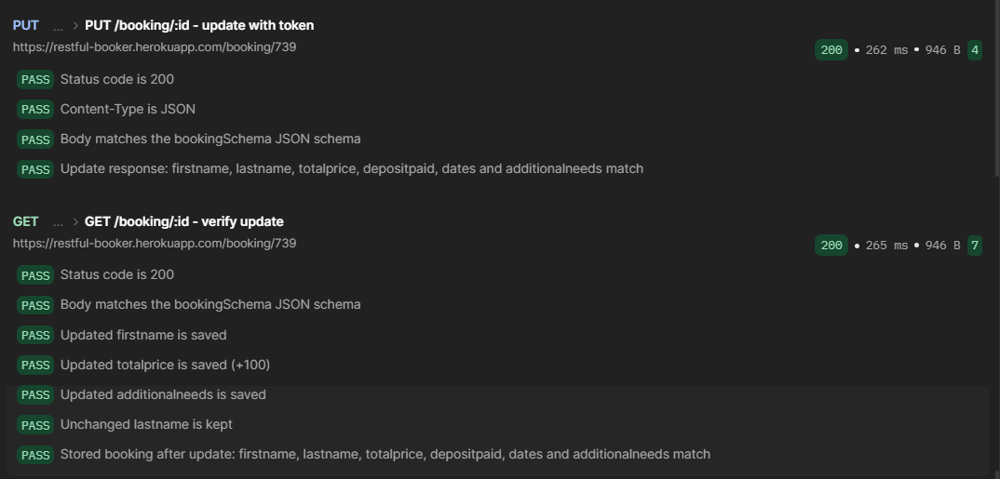
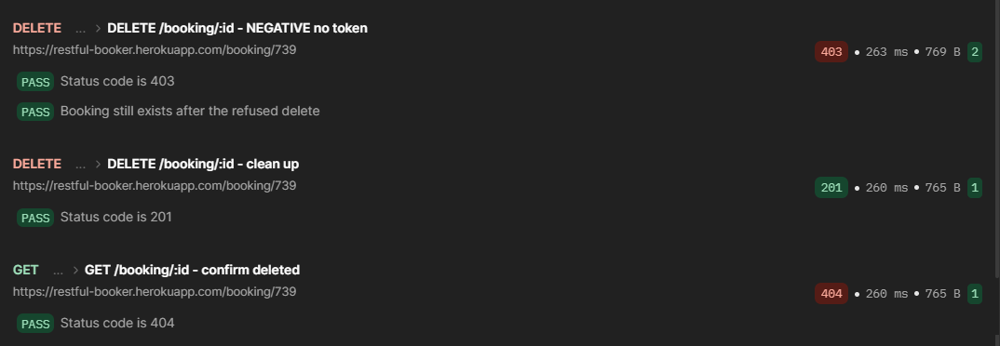
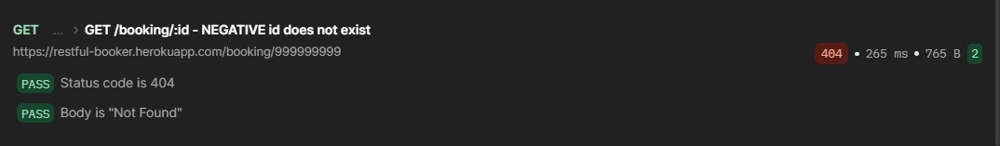
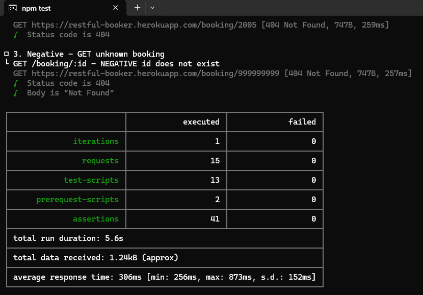

# Restful-Booker API tests (Postman + Newman)

Postman collection that tests the full booking lifecycle of [Restful-Booker](https://restful-booker.herokuapp.com/apidoc/index.html) as one chained flow: **auth → create → update → verify → delete**. It also covers negative cases and checks status codes, JSON schemas and response data.

**Result: 13 requests, 41 assertions, all passing.** Red 403 and 404 badges are expected; those negative tests check that the API refuses the request.

## Run it

| Where | How |
| --- | --- |
| Postman | Import `collections/…collection.json` and `environments/…environment.json`, select **Restful-Booker (public demo)**, then **Run collection** |
| Command line | `npm install` then `npm test`. Reports are written to `reports/` |
| GitHub Actions | Runs automatically on push, pull request, nightly and on demand |

## Test run, step by step

**0. Health check.** `/ping` responds.



**1. Auth.** A valid login returns a token, saved as `{{token}}`. A wrong password gets no token.



**2. Create and read.** The booking id is saved as `{{bookingId}}`. Reading the booking back returns exactly what was sent.



**Negative: update without a valid token.** Refused with 403, and the booking is unchanged.



**3–4. Update and verify.** The new values are saved and fields that weren't updated are kept.



**5. Delete.** Without a token the delete is refused. With the token the booking is deleted, and reading it again returns 404.



**Negative: unknown booking.** Returns 404.



**Same suite from the command line (`npm test`).** Newman counts 15 requests because it includes 2 follow-up reads sent from test scripts.



## Defects found

| ID | Defect |
| --- | --- |
| BUG-07 | A wrong password returns **200** with `"Bad credentials"` instead of **401** |
| Quirk | `/ping` and `DELETE` return **201** instead of 200 |

## Files

```
collections/    Postman collection
environments/   base URL and demo credentials
scripts/        source that generates the collection (npm run build)
.github/        CI workflow
docs/images/    screenshots
```
